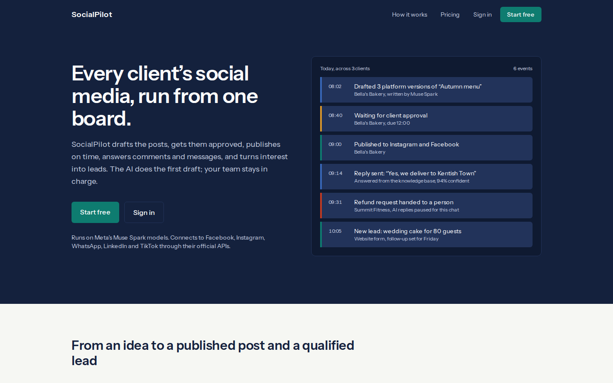
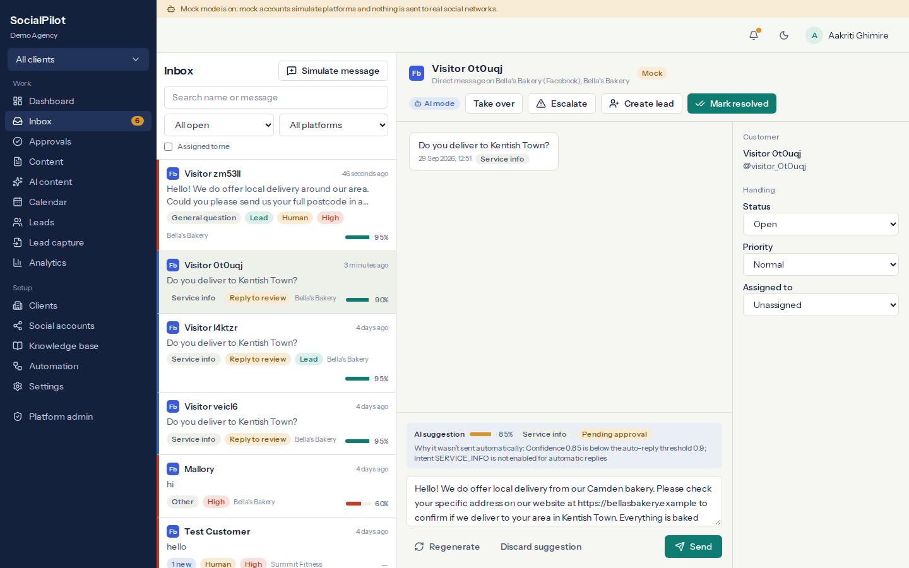
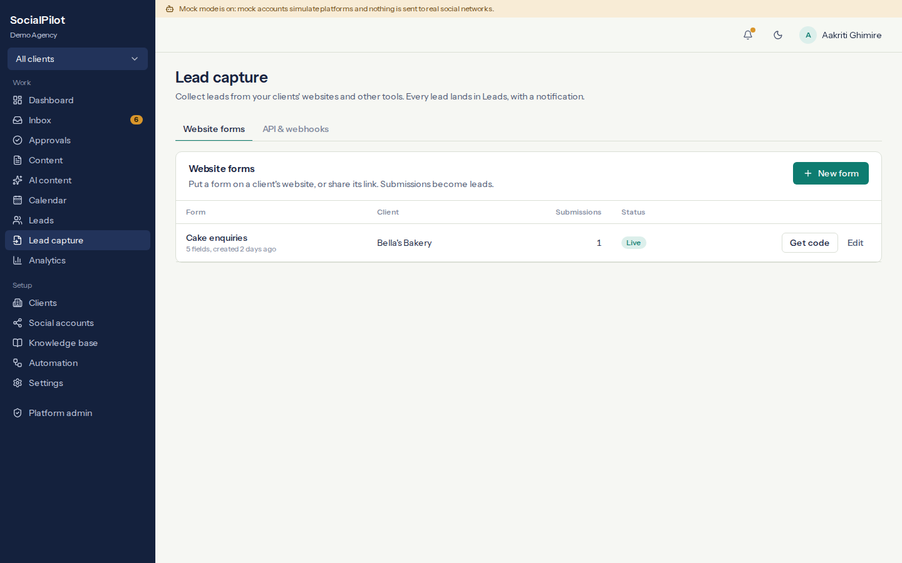
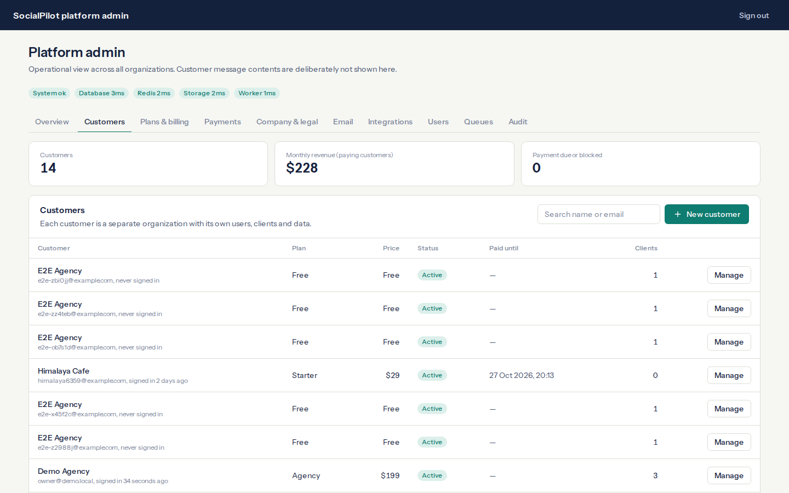
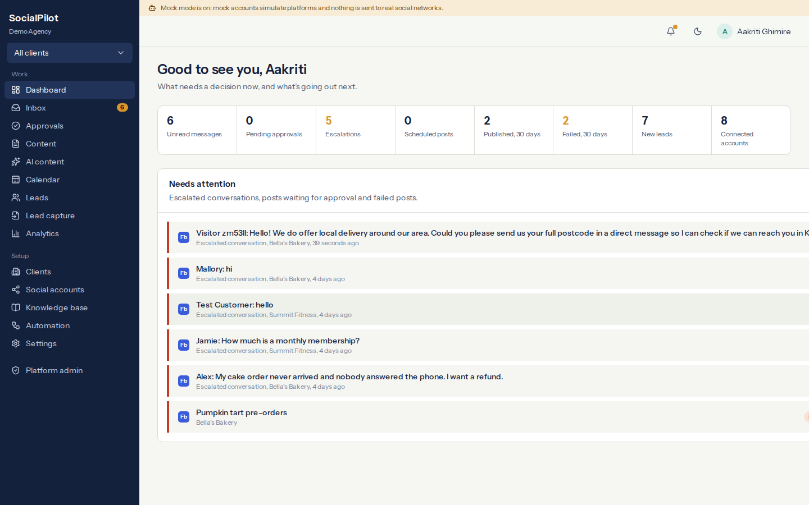
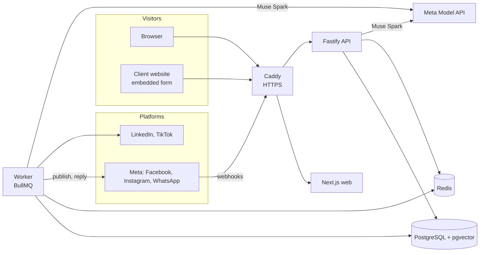

# SocialPilot AI

[](https://github.com/aancur2002/socialpilot-ai/actions/workflows/ci.yml)

**Every client's social media, run from one board.** SocialPilot is a multi-tenant SaaS for agencies and small businesses. It drafts posts, gets them approved, publishes on schedule, answers comments and messages, and turns interest into leads. The AI (Meta's **Muse Spark**) does the first draft of everything; people stay in charge of what goes out.



## Why it exists

An agency managing 30 local businesses can't read every comment and DM, or write a week of posts for each client. SocialPilot does that first draft, grounded in each business's own facts, and routes anything uncertain, sensitive or risky to a person.

## What it does

| | |
|---|---|
| **AI content** | One idea becomes a separate version for each platform, in the client's brand voice, with hashtags and a call to action, plus an image made with Muse Image. |
| **Approvals and publishing** | Client or approver sign-off, a drag-and-drop calendar, and publishing through official APIs with retries and duplicate protection. |
| **Unified inbox** | Comments and DMs from every connected account. The AI labels intent, drafts a reply from the client's knowledge base, scores its confidence, and then sends it, holds it for review or hands it to a person, following per-client rules. |
| **Lead capture and CRM** | Leads from conversations, embeddable website forms, a lead API for Zapier or Make, and signed webhooks out to other systems. Pipeline, follow-up reminders, notes and CSV export. |
| **Knowledge base** | Documents, FAQs and website pages, searched semantically (pgvector) so replies quote the business's own facts. |
| **Analytics** | Platform metrics kept as history, with AI-written summaries. A number a platform doesn't provide is shown as unavailable, never guessed. |
| **Run it as a SaaS** | Customer accounts, plans with prices and limits, trials, payments (manual now, Stripe ready), automatic pausing of unpaid accounts, a platform admin console, legal pages and email. |

Platforms: Facebook, Instagram, WhatsApp, LinkedIn and TikTok, through official OAuth and APIs only. Each has a **mock** twin, so the whole product can be tried without platform credentials.

| Inbox: an AI draft held for review | Lead capture | Platform admin: customers |
|---|---|---|
|  |  |  |



## Built during the Meta AI Developer Hackathon (Oct 26 – Nov 4, 2026)

SocialPilot existed before the event. Everything below was built during it; the git tag [`hackathon-start`](https://github.com/aancur2002/socialpilot-ai/tree/hackathon-start) marks the code as it was before, so `git diff hackathon-start` shows exactly what's new.

| Feature | What it does | Meta models |
|---|---|---|
| **Campaign Agent** | Give a goal ("fill our weekend baking classes"). The agent reads the business profile, checks facts in the knowledge base, looks at recent posts, plans an arc, writes each post for every connected platform, creates a sign-up form and images, and sends everything for approval. A live timeline shows each tool call. Details it doesn't know become `[placeholders]` for the owner, never invented facts. | **Muse Spark Open** (tool calling), Muse Image |
| **Voice-note inbox** | Customers' WhatsApp voice notes are transcribed (with the business's product names as recognition hints) and then answered like typed messages: knowledge-based reply, confidence score, lead capture. The team can play the note back and see which model transcribed it. | **Muse Voice Transcribe** (backup: Gemini audio) |
| **Product photo studio** | From a phone photo, SAM 3.1 cuts out the product you name. The cutout becomes a square studio shot on the brand colour, and Muse Image places the same product in a new scene (a Dashain table, a Himalayan backdrop, a café). | **SAM 3.1**, **Muse Image** edits |
| **Meta open weights** | Muse Spark Open on Baseten, or Muse Glimmer on your own Modal GPU (`infra/modal/glimmer.py`), as the main model or a backup, so a business can run on open weights. | **Muse Spark Open**, **Muse Glimmer** |

Verified live: the Campaign Agent runs end to end on Muse Spark Open through Baseten (13 tool calls in about 25 seconds). The Muse Voice Transcribe, SAM 3.1 and Muse Image calls follow Meta's documented APIs and are covered by tests with recorded responses; running them live needs Meta Model API billing.

## Built on Meta's models

Every AI step runs on Meta's models: **Muse Spark** through the Meta Model API (`https://api.meta.ai/v1`), or the open-weight **Muse Spark Open** (Baseten) and **Muse Glimmer** (your own Modal deployment):

| Step | What Muse Spark does | Reasoning effort |
|---|---|---|
| Post writing | A version per platform in the client's voice | medium |
| Inbox triage | Question, complaint, lead or spam, for every comment and DM | minimal |
| Grounded replies | An answer from the client's knowledge base, with a confidence score | medium |
| Lead extraction | Name, need and contact details from a conversation | minimal |
| Reports | A plain-language summary of a client's month | medium |
| Post images | **Muse Image** turns each post's creative brief into a picture sized for the platform | — |
| Campaigns | The Campaign Agent plans and drafts a whole campaign by calling tools | low |
| Voice notes | **Muse Voice Transcribe** turns customer voice notes into text | — |
| Product photos | **SAM 3.1** cuts the product out; **Muse Image** edits place it in a new scene | — |

Structured steps use strict JSON schema output, validated before use. Prompt-injection defences keep customer messages from steering the AI. If Muse Spark is busy or unavailable, up to three backup providers (Google Gemini, NVIDIA NIM, OpenAI, Anthropic) take over automatically. Knowledge search uses Gemini or NVIDIA embeddings, since the Meta Model API has no embedding model.

## Architecture



- **Tenancy:** every query is scoped by organization and client; out-of-scope records return 404. Nine roles are enforced in the API.
- **Security:** AES-256-GCM encrypted tokens and keys, CSRF origin checks, rate limits and per-account lockout, CSP and HSTS, signed webhooks in both directions, SSRF-safe fetching, and an audit log. Details: [docs/security.md](docs/security.md).
- **Reliability:** idempotent publishing with atomic claims, per-message locks in the reply pipeline, retries with backoff, and AI provider failover.

## Try it locally (about 5 minutes)

Requirements: Node.js 22+, npm 10+ and Docker.

```bash
git clone https://github.com/aancur2002/socialpilot-ai.git && cd socialpilot-ai
npm install
cp env.example .env        # then set ENCRYPTION_KEY and JWT_SECRET (commands are in the file)
npm run infra:up           # Postgres (pgvector) on :5434, Redis on :6380
npm run db:migrate
npm run db:seed            # demo agency, 3 clients, mock accounts, posts, conversations, leads
npm run dev                # web :3000, API :4000, worker
```

For a demo with simulated social accounts (no `.env` change needed): `npm run demo`. To get fresh demo data while keeping the AI keys saved in Settings: `npm run demo:reset`.

Open http://localhost:3000. Every demo user's password is `demo-password-2026`:

| User | Role |
|---|---|
| owner@demo.local | Agency owner |
| manager@demo.local | Manager |
| content@demo.local | Content manager |
| approver@demo.local | Approver |
| client@demo.local | Client (one client only) |
| admin@socialpilot.local | Platform admin |

To use Muse Spark: **Settings → AI models → Meta Model API**, paste your key, **Test connection**. Without a key the app runs on a deterministic offline AI.

## Deploy

One server, one command, automatic HTTPS and daily backups:

```bash
cp env.production.example .env   # fill in the domain and secrets
docker compose -f docker-compose.prod.yml up -d --build
```

Step by step: [docs/deployment.md](docs/deployment.md).

## Quality

```bash
npm run lint && npm run typecheck   # zero warnings, strict TypeScript
npm run test:all                    # unit and integration tests
npm run test:e2e                    # Playwright browser tests (stack running and seeded)
```

Integration tests cover tenant isolation, publishing, the inbox pipeline, billing, lead capture, password reset and payments. GitHub Actions runs everything, plus the production image builds, on every push.

## Repository

```
apps/
  api/        Fastify REST API: auth, tenancy, webhooks, public lead endpoints, OpenAPI
  worker/     BullMQ workers: publishing, replies, webhooks, knowledge, analytics, email, reminders
  web/        Next.js app: dashboard, inbox, content, calendar, CRM, lead capture, settings, admin
packages/
  ai/         Providers (Meta, Baseten, Modal, Anthropic, OpenAI, Gemini, NVIDIA), failover, agents, transcription, segmentation
  core/       Tenant-scoped business services shared by the API and worker
  social/     Platform adapters (real and mock), capability matrix
  database/   Prisma schema and migrations (pgvector)
  auth/ config/ validation/ storage/
infra/        Dockerfile, Caddy, backups, Modal deployment for Muse Glimmer
docs/         Architecture, deployment, security, AI, database, integrations
tests/        Integration tests
```

## Documentation

- [How to use SocialPilot](HOW_TO_USE.md): every feature, step by step
- [Deployment](docs/deployment.md), [Security](docs/security.md), [AI system](docs/ai.md), [Architecture](docs/architecture.md), [Database](docs/database.md)
- Integrations: [Facebook](docs/integrations/facebook.md), [Instagram](docs/integrations/instagram.md), [WhatsApp](docs/integrations/whatsapp.md), [LinkedIn](docs/integrations/linkedin.md), [TikTok](docs/integrations/tiktok.md)
- [Hackathon notes](HACKATHON.md), [Build status](BUILD_STATUS.md), [To do](TODO.md)

## Status

The product runs end to end with mock platform accounts. The real platform adapters follow each platform's documented API but haven't been verified against live accounts yet; that needs approved developer apps (for Meta, App Review). See [BUILD_STATUS.md](BUILD_STATUS.md).

## License

Copyright © 2026 Anup Ghimire. Licensed under the [GNU Affero General Public License v3.0](LICENSE) (AGPL-3.0-only): you may use, modify and share it, but if you run a modified version as a network service, you must publish your source code under the same license.
